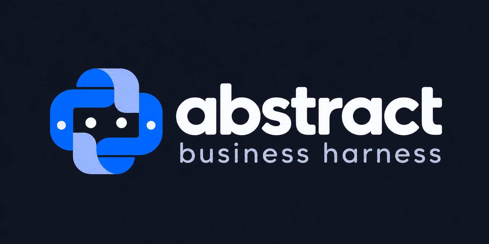

# abstract



A long-horizon **analysis agent engine**. Domain logic — tools, skills,
instructions, credentials — lives in a **profile directory** you pass at
runtime. This repository has no customer data and is meant to be public.

It was first built for a large agro commodity producer: multi-hour analyses
against an internal planning system, delivered as HTML reports. The engine
is the reusable half of that design. How to write a profile like that one
(lessons included, no confidential names or figures) is in
[docs/authoring-profiles.md](docs/authoring-profiles.md).

This is usable for real work, and it is still experimental. Run it on a
machine you control. A host that can reach customer data, production
systems, or other material you cannot afford to expose is the wrong place
for it. Passwords and API keys are a basic gate, not a reason to put the
process somewhere sensitive.

A profile tool runs with the same privileges as the engine. Do not add one
that reads or writes data until you have worked through what it can reach,
what it can change, and what a wrong or hostile call would do.

## Docker Hub

Pull the published image instead of building it:

```bash
docker pull dkatz23238/abstract-business-harness
```

`latest` is the newest release. Pin a deploy to a version tag such as
`0.2.0` (or `0.2` to follow patch releases). How to run the container is in
[Docker](#docker) below.

```bash
uv sync
HARNESS_ADMIN_PASSWORD='choose-a-password' uv run abstract serve --profile profiles/example --port 8811
# other terminal
cd ui && npm install && VITE_API_URL=http://localhost:8811 npm run dev
```

Open the Vite URL (5173, or 5174+ if that port is taken) and sign in as
`admin` with that password. The UI proxies
`/agui`, `/profile`, and the other engine routes to `VITE_API_URL`, so a
second Vite on another localhost port does not need CORS. The example
profile talks to a public JSON API and uses `openai:gpt-5.6-luna` (needs
`OPENAI_API_KEY`). Set `OPENAI_BASE_URL` to send that client to an
OpenAI-compatible server such as OpenRouter
(`https://openrouter.ai/api/v1`); leave it unset to use OpenAI. For a
no-key smoke test, set `[model] spec = "test"`.

Claude works the same way: `spec = "anthropic:claude-sonnet-5"` with
`ANTHROPIC_API_KEY` set. The engine turns on adaptive thinking at the chat's
effort level and Anthropic prompt caching. List more specs in
`[model] choices` and the chat shows a model picker:

```toml
[model]
spec = "anthropic:claude-sonnet-5"
choices = ["openai:gpt-5.6-luna"]
```

A production build of the UI is served by the same process. `npm run build`
in `ui/` (with `VITE_API_URL` empty) writes `ui/dist`, and `abstract serve`
then returns that app at `/`. Set `HARNESS_UI_DIR` to point somewhere else.

## Docker

The image contains the engine and that UI build. The profile and its state
stay on the host:

```bash
docker build -t abstract .
docker run --rm -p 8811:8811 \
  -e OPENAI_API_KEY \
  -e ANTHROPIC_API_KEY \
  -e HARNESS_ADMIN_PASSWORD \
  -v "$HOME/eia-profile:/harness-profile" \
  abstract
```

Image tags on `dkatz23238/abstract-business-harness`:

| Tag | Moves when |
| --- | --- |
| `0.2.0` | never; one release |
| `0.2` | each `0.2.x` release |
| `latest` | each release |
| `main` | each push to `main` (unreleased) |
| `sha-<short commit>` | never; one commit |

A release is a `vX.Y.Z` git tag matching `abstract.__version__`; the
workflow refuses to publish a tag that doesn't match. Changes are in
[CHANGELOG.md](CHANGELOG.md). `GET /healthz` (no auth) returns the running
version.

Open `http://localhost:8811`. The image reads one mount, `/harness-profile`.
A `profile.toml` there is the profile; otherwise `profile/profile.toml` is.
State goes to `harness-data/` when that directory exists, otherwise `data/`.
An env value that is an absolute path to a missing file is reread from the
same filename in the mount, so host paths stored in `profile.toml` still
find the databases next to the profile. `LOGFIRE_TOKEN` is optional.
`HARNESS_ADMIN_PASSWORD` is required on the first start (see
[Users and API keys](#users-and-api-keys)). The mount has to be writable by
uid 1000.

## Layout

```
abstract/            engine package (CLI: abstract)
profiles/example/    public demo profile
docs/                authoring guide
ui/                  AG-UI frontend; strings come from GET /profile
data/                gitignored per-profile state
```

Under the data root:

```
users.json, session_secret      accounts (0600); shared by every profile
<profile>/users/<user>/state/   threads, history, memory, plans.db
<profile>/users/<user>/workspaces/<thread_id>/
<profile>/shared/memory/        only with [memory] scope = "shared"
<profile>/layout_version
```

`[memory] scope` in `profile.toml` is `"user"` (default: each user has their
own notebook) or `"shared"` (one notebook for everyone on the profile).

A real customer profile is a **separate private git repo**. Point
`--profile` at it and `--data-root` at its `data/` so threads stay next to
the profile, not in this checkout.

## Profile in one page

```
profile.toml          model, code tool name, skills, tool modules, env, limits
instructions.md       domain prompt; may embed {{ core.* }} engine blocks
memory_guidance.md     optional
skills/<name>/SKILL.md
tools/*.py            each may expose register(ctx) -> FunctionToolset
ui.json               title, placeholder, data_calls_label, data_source_name
```

Environment declared in `[env]` resolves as:

1. `<PROFILE_ID>_<NAME>` in the process environment
2. bare `<NAME>` in the process environment
3. `<data-root>/<id>/secrets.env` (0600, gitignored)
4. `[env.defaults]` in profile.toml

`abstract profile validate --profile PATH` prints a report and fails on
missing required env or a broken tool module.

## CLI

```
abstract serve --profile PATH [--port 8811]
abstract chat --profile PATH [-p prompt] [-v]
abstract profile validate --profile PATH
abstract profile env-list --profile PATH
abstract profile env-set NAME VALUE --profile PATH
abstract history --profile PATH [--user NAME] [session]
abstract profile new DIR [--from PATH]
abstract users list|add|reset-password|rotate-key --data-root PATH
```

`chat` and `history` act as `admin` unless `--user` says otherwise. `users`
works on `users.json` directly, without a running server; it is how you get
back in after losing the admin password.

## Users and API keys

The first `abstract serve` on a data root creates the `admin` account from
`HARNESS_ADMIN_PASSWORD` (8+ characters) and prints admin's API key once.
Without the variable the server refuses to start. After that, `users.json`
is the source of truth and the variable is ignored; change the password in
the UI or with `abstract users reset-password admin`. Set
`HARNESS_ADMIN_API_KEY` on that first start to pick admin's key instead of
getting a generated one.

Admins add users in the **Users** tab or with `POST /admin/users`. Each user
has:

- a **role**: `user`, or `admin` (manage users and the profile, read every
  thread)
- a **visibility**: `siloed` (only their own threads) or `shared` (can also
  open other users' threads, read-only)
- a password, for the web UI
- an API key (`bh_…`), for scripts; shown once when created or rotated

Every route except `/auth/login`, `/healthz`, `/docs`, and the built UI
requires a credential: `Authorization: Bearer <api key or session token>`,
or `?token=<…>` when the client cannot set a header (the tool-event stream
and report iframes).

`POST /auth/login` with `{"username": …, "password": …}` returns a session
token valid for 30 days. Changing a password ends that user's sessions; API
keys keep working until rotated (`POST /me/api-key`, or an admin's
`POST /admin/users/{name}/api-key`). Five wrong passwords within five
minutes, for one username or from one client address, lock that username or
address out of login for five minutes.

```bash
TOKEN=$(curl -s http://127.0.0.1:8811/auth/login \
  -H "Content-Type: application/json" \
  -d '{"username": "admin", "password": "…"}' | jq -r .token)
curl -s http://127.0.0.1:8811/me -H "Authorization: Bearer $TOKEN"
```

## Start a thread

`POST /agui` starts a thread (a new `threadId`) and streams AG-UI events.
`-N` makes curl print each event as it arrives:

```bash
curl -N http://127.0.0.1:8811/agui \
  -H "Authorization: Bearer $API_KEY" \
  -H "Content-Type: application/json" \
  -d '{
    "threadId": "thread-1",
    "runId": "run-1",
    "messages": [{"id": "m1", "role": "user", "content": "Hello"}],
    "tools": [],
    "context": [],
    "forwardedProps": {},
    "state": {}
  }'
```

`$API_KEY` is your API key (admin's is printed on the first start). The
thread belongs to whoever's key made the call. `forwardedProps.effort` may be
`low`, `medium`, `high`, or `xhigh`. `forwardedProps.model` may be any spec
in the profile's `model_choices` (`GET /profile`); other values run on the
default. A thread keeps the model it last ran on.

## Reading other users' threads

Admins and `shared` users add `?owner=<username>` to read someone else's
thread: `GET /threads/{id}`, `/runs/{id}`, `/events/{id}`,
`/agui/{id}/attach`, `/workspace/{id}/files`, and `/workspace/raw/…`.
`GET /threads?scope=all` lists every thread they can read, each with an
`owner` field. Writes (`POST /agui`, `PUT`/`DELETE /threads/{id}`) only ever
touch the caller's own threads.

## Workspace files

Each thread writes files under its owner's `workspaces/<thread_id>/`. `GET
/workspace/{thread_id}/files` is in `/docs` and returns the relative paths:

```bash
curl -s http://127.0.0.1:8811/workspace/thread-1/files \
  -H "Authorization: Bearer $API_KEY"
```

```json
{
  "root": ".../workspaces/thread-1",
  "files": [
    {"path": "reports/summary.html", "size": 1234, "mtime": 1750000000.0, "kind": "html"}
  ]
}
```

`path` is relative to that thread's workspace. Dotfiles are omitted.

Fetch the bytes by appending that `path` to `/workspace/raw/<thread_id>/`:

```bash
curl -L -o summary.html \
  -H "Authorization: Bearer $API_KEY" \
  "http://127.0.0.1:8811/workspace/raw/thread-1/reports/summary.html"
```

URL-encode spaces and other reserved characters in `path`. `?token=$API_KEY`
works in place of the Bearer header; the UI uses that for report iframes.

## Admin

`/admin/*` takes the same credentials as every other route, and the account
must have the `admin` role (others get 403). It rewrites
tools/skills/instructions, sets env values, reloads the profile, and
manages users. Writes are validated before they land; previous files go to
`_history/` under the profile. **Tools are trusted code**: same privileges
as the engine process, so only give the admin role to people you would give
shell access.

The web UI shows **Users** and **Admin** tabs to admins.

Upgrading from 0.1: see [docs/upgrade-0.2.md](docs/upgrade-0.2.md).

## License

MIT. See [LICENSE](LICENSE).
